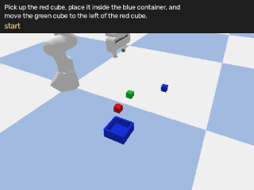

# Project ECHO — Embodied Cognitive Hierarchy for Operations

Simulated tabletop manipulation (PyBullet, Franka Panda) with language-conditioned planning, a learned
action-conditioned world model, prediction-discrepancy failure detection, and goal-level recovery.

## Setup (Windows)
PyBullet has no PyPI wheel for Windows, so use conda-forge:
```
conda create -n echo -c conda-forge --override-channels python=3.11 pybullet numpy opencv matplotlib pandas
pip install torch --index-url https://download.pytorch.org/whl/cpu
```
Then `conda install -n echo -c conda-forge --override-channels "libblas=*=*openblas" nomkl` - conda's MKL numpy and pip torch
load two OpenMP runtimes; this clashes with OpenCV+torch in one process and silently kills multiprocessing workers.

**Report:** [docs/REPORT.md](docs/REPORT.md) · **Figures:** `results/figures/` · **Demos:** `results/videos/`



*A failed grasp is detected from the prediction error (22 cm) and the system re-plans and completes the task.*
Other demos: `01_language_task`, `03_knocked_cube_recovery` (GIF and MP4).

## Layout
| Path | Purpose |
|---|---|
| `echo/env.py` | PyBullet environment, state extraction, camera, action primitives, failure injection |
| `echo/parser.py`, `task.py` | Rule-based instruction parser -> goals (no API, deterministic) |
| `echo/planner.py` | Goal -> skill decomposition, late-bound placement targets, goal verification |
| `echo/executor.py` | Open-loop pipeline (Baseline A) |
| `echo/wm_data.py`, `worldmodel.py` | State/action encoding; 5-member MLP ensemble world model |
| `echo/perception.py` | OpenCV colour segmentation on a top-down camera -> object positions (0.43 cm mean error) |
| `echo/recovery.py` | Monitoring, discrepancy detection, replanning/recovery; all ablation modes |
| `scripts/` | demos, data generation, training, detector calibration, evaluation, summary |

Frame convention: robot at origin facing +x; left = +y; "in front of" = toward the robot.

## Pipeline to reproduce
```
python scripts/gen_data.py 1500 data_train.npz 1000 3
python scripts/train_wm.py data_train.npz 200 --nominal        # expected-outcome model
python scripts/calibrate_detector.py checkpoints/wm_nominal.pt detector_nominal.json
python scripts/eval_phase4.py 60 3 checkpoints/wm_nominal.pt 0.05 open_loop,verify_retry,no_wm,echo_detect_only,echo phase5 200
python scripts/summarize.py phase5_results.json
```

## Key design decision
The world model is trained on **successful** transitions only, so it predicts the *expected* outcome of an action.
A model trained on all outcomes hedges on grasps (15% fail at random), which made ordinary picks look surprising
(13% false alarms). Expected-outcome training makes a failed grasp a clean ~22 cm surprise vs ~1 cm normally.

## Results (held-out layouts 200-259, 60 episodes/cell, identical layouts & injections across modes)
See `results/phase5_summary.txt` for the full table with 95% CIs and paired tests.

| Scenario | open loop | verify+retry | rules+recovery | WM detect only | **ECHO** |
|---|---|---|---|---|---|
| nominal | 0.98 | 0.98 | 0.98 | 0.95 | 0.98 |
| failed grasp | 0.10 | 0.98 | 0.98 | 0.10 | 0.98 |
| object knocked | 0.07 | 0.83 | 0.90 | 0.07 | 0.87 |
| 2 obstacles (unseen arrangement) | 0.92 | 0.92 | 0.92 | 0.88 | 0.92 |

Detector (step level): ECHO recall 1.00, false alarms 0.06; rule-based monitor recall 0.60.

### Camera-only run (same layouts; all decisions use perceived state, scoring on true state)
| Scenario | ECHO, true state | ECHO, camera |
|---|---|---|
| nominal | 0.98 | 0.98 |
| failed grasp | 0.98 | 0.97 |
| object knocked | 0.87 | 0.75 |
| 2 obstacles | 0.92 | 0.90 |

Perception cost is negligible except after a knock (cause not yet traced). Add `--perception` to `eval_phase4.py`.

## Limitations (read before citing)
- **Recovery is the effect; the world model is not yet shown to add task success.** ECHO ties the no-world-model
  variants (paired tests p >= 0.5). Its measured advantage is detection that needs no privileged signal.
- The rule-based baseline uses simulator-provided success flags and ground-truth goal checks; a real robot would not have them.
- Detection threshold (5 cm) was tuned on layouts 0-23; reported results use layouts 200-259.
- World model covers a fixed scene (3 cubes + 1 container); obstacles are not in its state.
- Residual failures are physical: blocked target regions and grasps that close on a container wall.
- Predictive planning (Baseline B) was not built: with this action space it would choose the same placements as Baseline A.
- Simulated only; single seed family; perception is classical colour segmentation, so it relies on distinctly coloured objects and a fixed camera.
