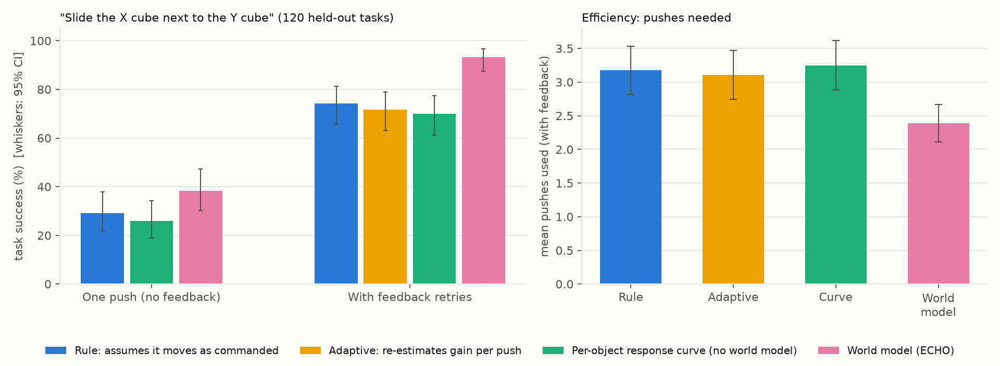

# Project ECHO: Predictive World Models for Failure Detection and Recovery in Language-Conditioned Manipulation

*Technical report. Simulation only (PyBullet). All numbers are reproducible from the scripts in `scripts/`; raw outputs are in `results/`.*

## 1. Summary

ECHO is a simulated tabletop robot (Franka Panda) that parses a natural-language instruction, plans a sequence of skills,
predicts the outcome of each action with a learned world model, compares the prediction with what it observes through a camera,
and replans when they disagree.

**Main findings**

1. **Detection plus recovery is what matters.** Under injected failures, open-loop execution drops to 7-10% task success.
   Detecting the failure *and* replanning restores 75-98%. Detection alone does not help (it stops the run).
2. **The learned world model detects failures well, without privileged signals.** It flags 100% of failed grasps and of bad steps in live runs
   (6-8% false alarms). A rule-based monitor that does not use the world model catches 60-63% of bad steps, and only because it reads the
   simulator's own success flag.
3. **In the pick-and-place failure scenarios the world model did *not* improve task success** over a simple rule-based recovery
   baseline (paired sign tests, p >= 0.125): the failures are visible after the fact, so cheap checks suffice once a monitor exists.
4. **Where prediction does help: acting under hidden physics.** In push tasks whose outcome depends on unknown object friction,
   choosing the push command from the world model's *predicted* outcome raised success from 74% to **93%** over the best
   feedback-only conventional planner (paired 24 vs 1, p < 0.0001) and used fewer pushes (2.4 vs 3.2). A per-object response curve
   fitted on the same data (no world model) reached only 70%. See Section 6.
5. **A camera costs little**, except after a cube is knocked (87% -> 75%).

## 2. System

| Module | Implementation |
|---|---|
| Environment | PyBullet, Franka Panda, 3 coloured cubes, 1 open container, optional obstacles; IK + position control |
| Language | Rule-based parser (deterministic, no API) -> goals such as `in(red_cube, blue_container)`, `left_of(green_cube, red_cube)` |
| Planning | Goal -> skills (`pick`, `place_in`, `place_rel`); placement targets resolved at execution time and checked for clearance |
| Perception | OpenCV colour segmentation on a top-down camera, back-projected to table coordinates |
| World model | Ensemble of 5 MLPs (3x256) predicting the normalised state change `s' - s` from `(s, a)` |
| Monitor | `e_t = max over objects of ||predicted - observed position||`; failure if `e_t` > 5 cm |
| Recovery | Goal-level replanning: re-check every goal against the observed state, re-plan skills for unmet goals |

Frame convention: robot at the origin facing +x; left = +y; "in front of" = toward the robot.

### Design decision: train on expected outcomes
Grasps fail at random about 15% of the time in the training data. A model trained on all outcomes learns to hedge (predict a
half-lifted cube), so *normal* grasps look surprising: 13-15% false alarms live. Training on **successful transitions only** makes the model
predict the *expected* outcome, so a failed grasp becomes a clean surprise of about 22 cm against about 1 cm for a normal action.

## 3. World model

Data: 6,000 transitions from 1,500 random episodes (random picks and placements, 15% injected grasp failures, 15% random object
displacements), split 80/10/10 **by episode**.

| Test set (600 transitions) | Mean object position error | "Nothing changes" baseline |
|---|---|---|
| All actions | 1.49 cm | 6.44 cm |
| Successful actions | 0.78 cm | 7.49 cm |

**Multi-step rollout** (the model fed its own predictions; test windows with a continuous, successful trajectory):

| Horizon | Windows | Rollout error | Copy-state baseline |
|---|---|---|---|
| 1 | 515 | 0.78 cm | 7.49 cm |
| 2 | 295 | 1.33 cm | 9.17 cm |
| 3 | 148 | 1.97 cm | 13.64 cm |
| 4 | 56 | 2.53 cm | 12.99 cm |

Error grows roughly linearly rather than compounding. Uncertainty: ensemble disagreement correlates with error (0.49 val, 0.60 test), which is
informative but not strong.

## 4. Failure detector

On held-out data the discrepancy separates failed grasps (all around 22 cm) from normal actions (AUROC 0.994). At the deployed 5 cm threshold:
failed-grasp recall is 1.00 (n=54). The false-alarm rate on the *random-action* test data is **12%** (pick 10%, place 21%, place-in 4%); the high place figure
comes from random placements that collide with other objects, which the planner avoids in real task runs. In live runs the step-level false-alarm rate was 6-8%.

## 5. End-to-end evaluation

60 held-out layouts per cell (layouts 200-259, never used for tuning), three task types, identical layouts and injected failures across all
variants. Success is always scored on the true simulator state.

Variants: **Open loop** (Baseline A) executes the plan once. **Verify + retry** has no step monitoring and only re-plans after a failed final check.
**Rules + recovery** monitors with the skill's own success flag and goal checks. **WM detect only** uses the world-model detector but aborts on detection.
**ECHO** uses the world-model detector plus replanning.

Ground-truth object state:

| Scenario | Open loop | Verify + retry | Rules + recovery | WM detect only | ECHO |
|---|---|---|---|---|---|
| Nominal | 0.98 | 0.98 | 0.98 | 0.95 | 0.98 |
| Failed grasp | 0.10 | 0.98 | 0.98 | 0.10 | 0.98 |
| Cube knocked after placing | 0.07 | 0.83 | 0.90 | 0.07 | 0.87 |
| 2 obstacles (unseen arrangement) | 0.92 | 0.92 | 0.92 | 0.88 | 0.92 |

Camera only (perceived state; perception error 0.43 cm mean, 0.9 cm max, no missed objects in 240):

| Scenario | Open loop | Verify + retry | Rules + recovery | WM detect only | ECHO |
|---|---|---|---|---|---|
| Nominal | 0.98 | 0.98 | 0.98 | 0.97 | 0.98 |
| Failed grasp | 0.10 | 0.95 | 0.97 | 0.10 | 0.97 |
| Cube knocked after placing | 0.07 | 0.77 | 0.82 | 0.07 | 0.75 |
| 2 obstacles | 0.88 | 0.90 | 0.90 | 0.87 | 0.90 |

95% Wilson intervals and all paired tests are in `results/phase5_summary.txt` and `results/phase5_percep_summary.txt`.

**Paired comparisons (ECHO-only wins / other-only wins)**

| Comparison | Failed grasp | Cube knocked |
|---|---|---|
| ECHO vs open loop (true state) | 53 / 0 | 48 / 0 |
| ECHO vs open loop (camera) | 52 / 0 | 41 / 0 |
| ECHO vs rules + recovery (true state) | 0 / 0 | 0 / 2 (p = 0.50) |
| ECHO vs rules + recovery (camera) | 0 / 0 | 0 / 4 (p = 0.125) |

## 6. Where prediction helps: pushing under hidden dynamics

The pick-and-place tasks above gave the world model nothing to *decide*. This experiment adds a decision whose outcome the
planner cannot compute from geometry.

**Task.** "Slide the X cube next to the Y cube": push the cube along the table (+/-y only) until its centre is 5-12 cm from the
reference cube (target 8.5 cm, a window of about +/-3.5 cm). The `push` skill takes a commanded distance, but the distance an object
really travels depends on its hidden friction (red 1.5, green 0.4, blue 0.9; table 0.8), which the planner is not told:
measured at a 12 cm command, blue travels about 13 cm, red about 7 cm (undershoots) and green about 18 cm (overshoots and slides).
Overshooting can also knock the reference cube. The parser maps "slide/push" to the push method and "next to" to a ring relation.

**World model.** Same architecture, with a push action encoding. Trained on 4,500 push transitions from 1,500 layouts drawn from the task
distribution (layout seeds disjoint from evaluation). On held-out pushes its along-push error is **3.0 cm**, against 6.5 cm for
the assumption "it moves as commanded". A first attempt trained on 3,006 pushes at random table positions was too coarse
(6.3 cm vs 11.6 cm: the arm tracks position-dependently, and the data was thin) and was replaced by the task-matched dataset.

**Planners** (all choose the push command; "retry" re-checks the goal and re-plans after each push, up to 6 pushes):
*rule* assumes the object moves as commanded. *adaptive* re-estimates a gain (travelled / commanded) after each push.
*curve* is a per-object polynomial response curve fitted on the same push data, ignoring all other state (the control for
"is a world model needed?"). *world model* searches candidate commands and picks the one whose predicted outcome is closest to the
target while penalising predicted disturbance of other objects.

120 held-out tasks, identical layouts for every planner:

| Planner | Success | 95% CI | First push succeeds | Mean pushes |
|---|---|---|---|---|
| Rule, one push | 0.29 | [0.22, 0.38] | 0.29 | 1.00 |
| Curve, one push | 0.26 | [0.19, 0.34] | 0.26 | 1.00 |
| World model, one push | 0.38 | [0.30, 0.47] | 0.38 | 1.00 |
| Rule + retries | 0.74 | [0.66, 0.81] | 0.29 | 3.17 |
| Adaptive + retries | 0.72 | [0.63, 0.79] | 0.29 | 3.11 |
| Curve + retries | 0.70 | [0.61, 0.77] | 0.26 | 3.25 |
| **World model + retries** | **0.93** | [0.87, 0.97] | 0.38 | **2.39** |

Paired on identical tasks (world-model-only wins / other-only wins): vs rule + retries 24 / 1, vs adaptive 27 / 1, vs curve 30 / 2 (all p < 0.0001);
one-push world model vs rule 18 / 7 (p = 0.043) and vs curve 29 / 14 (p = 0.032). Pushes needed: the world model uses fewer than rule in 52 tasks and
more in 18 (p = 0.0001).

**Reading it.**
- Prediction-guided command selection beats every conventional alternative tried, and the gap survives a no-world-model learned control.
- **The one-shot accuracy is modest** (38% on the first push). Most of the gain comes from better *corrective* commands during retries, not from
  hitting the window first time.
- **It does not help where the planner's assumption is already right:** for the blue cube (moves as commanded) the rule planner is better
  one-shot (0.61 vs 0.50).
- Hypothesis (not tested): the curve control lags because the real response depends on position (arm tracking) and on collisions with other
  objects, both of which the full-state model sees and a per-object curve does not.

## 7. Discussion

**What the evidence supports.** Prediction-based failure detection is accurate and needs no privileged signal; replanning turns detections into recovered tasks.
**What it does not support.** A task-success advantage for the world model over simpler monitors. In the knocked-cube scenario the point estimate
favours the rule-based variant (87% vs 90% true state, 75% vs 82% camera), and the false alarms of the world-model detector plausibly explain that
(each wastes a replan), though the differences are within noise at n=60.

Why the world model adds little in the pick-and-place scenarios: the failures are *visible after the fact* in a few state variables (is the cube lifted,
did it move), so cheap checks suffice once a monitor exists, and the planner already rejects collision-prone placements geometrically, so a model scoring
those candidates would pick the same ones. The push experiment (Section 6) is the case where the model has a real decision to make, and there it
helps clearly. The two results are consistent: a world model earns its place when it informs a *choice* under dynamics the planner does not know,
not when it only confirms an outcome.

**Residual failures are physical**: a target region fully blocked by other objects, and re-grasps that close the fingers on a container wall.

## 8. Limitations and threats to validity

- The rule-based baseline reads simulator-provided success flags and ground-truth goal checks, which a real robot would not have. This flatters it.
- The 5 cm detection threshold was tuned on layouts 0-23; reported results use layouts 200-259.
- One scene family (3 cubes + 1 container), one simulator, one failure model (slipped grasp, one knocked object). Obstacles are not part of the world model state.
- The push result uses one hidden-physics configuration, pushes along +/-y only (x-direction pushes were unreliable with this arm), ground-truth object
  state, and simple conventional baselines. Stronger conventional controllers (e.g. continuous visual servoing during the push) were not tried.
- "Next to" now means a 5-12 cm ring; earlier it was an alias for "right of".
- Perception is classical colour segmentation: it needs distinctly coloured objects and a fixed camera.
- No physical-robot validation. Camera-only results are simulated RGB, not real images.
- The experiments are small (n=60 per cell); differences below about 10 points are not resolvable.

## 9. Reproducing

See `README.md`. Videos of nominal execution, failed-grasp recovery and knocked-cube recovery are in `results/videos/`.
